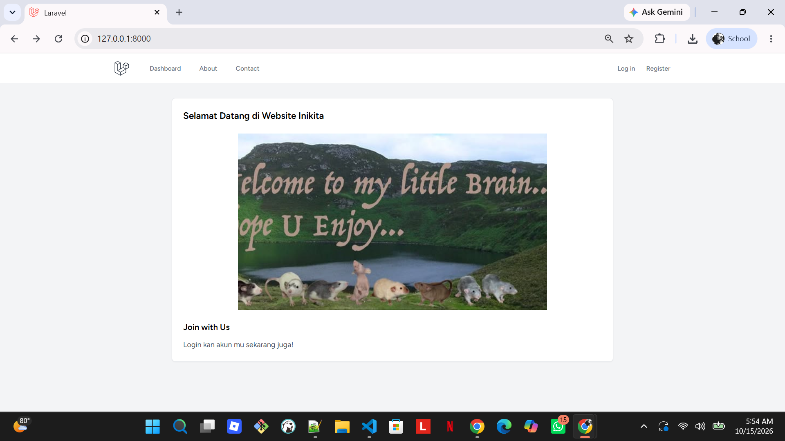
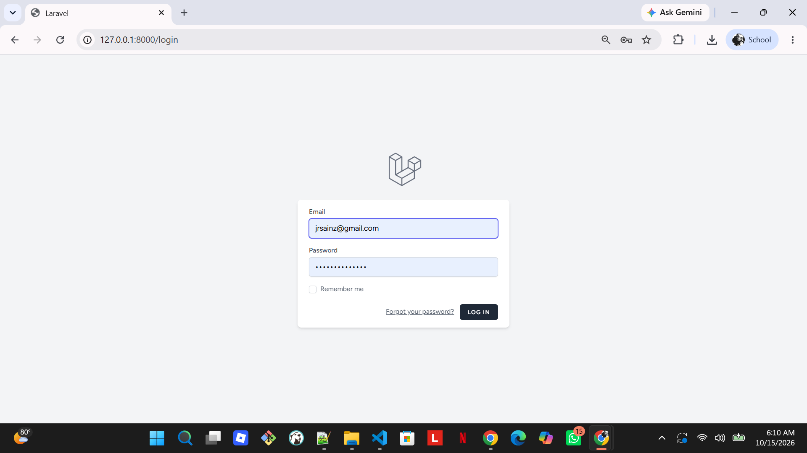
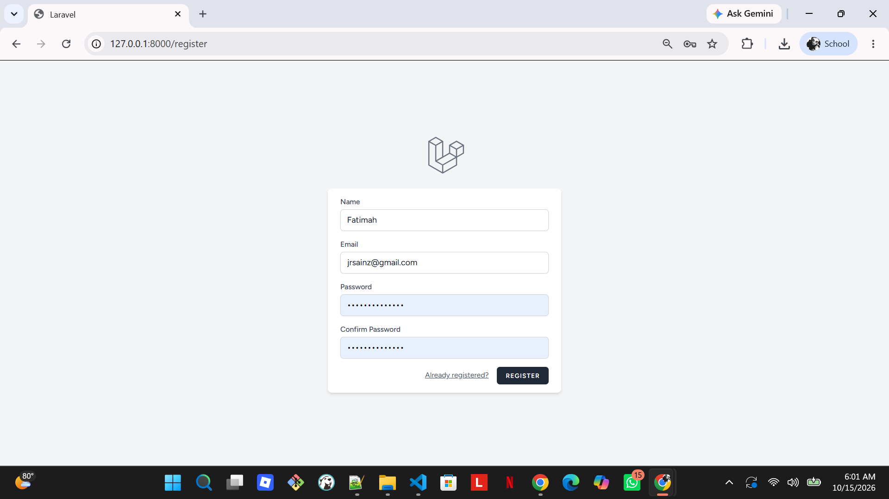
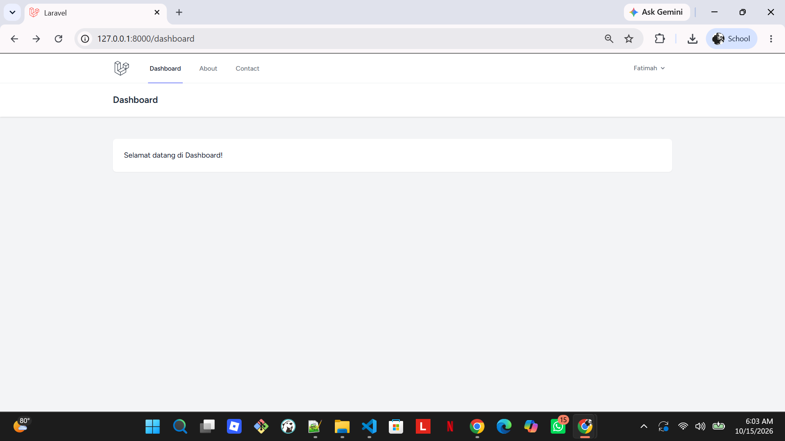
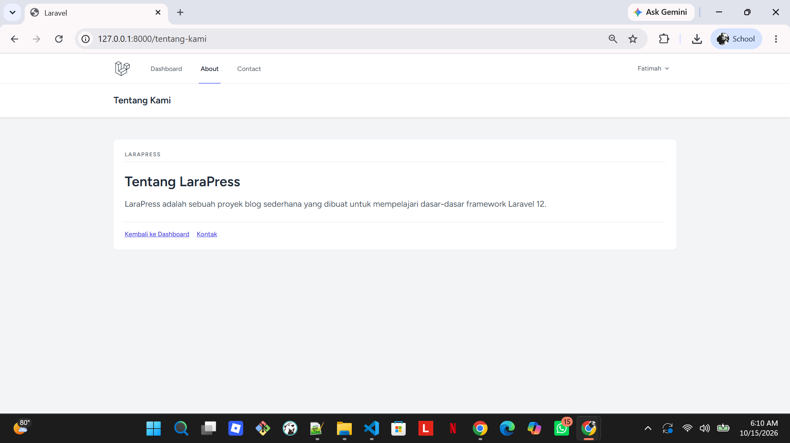
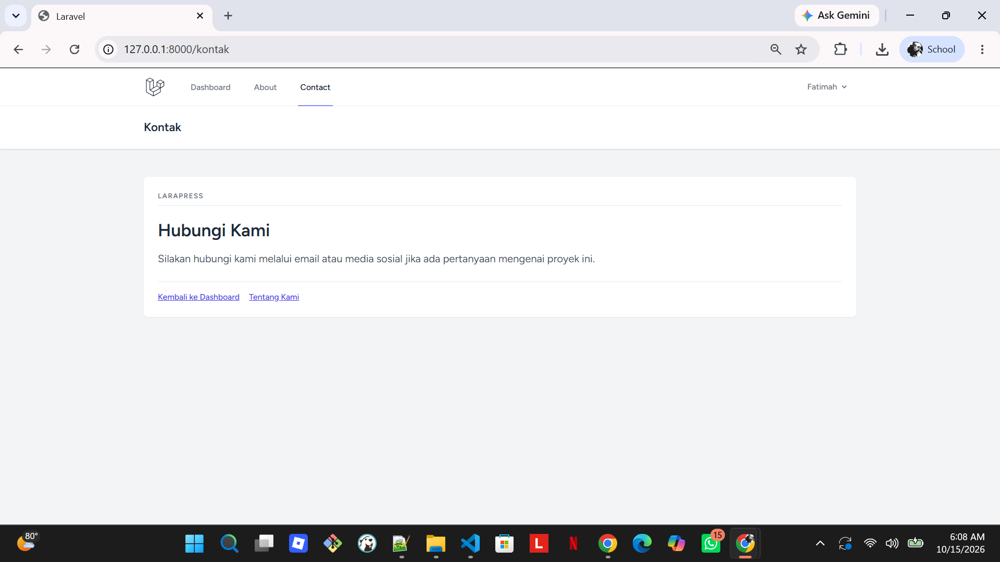

# TUGAS PERTEMUAN 3 - PRAK PEMROGRAMAN BERBASIS WEB

| **Nama** | Fatimah |
|---|---|
| **NPM** | 4524210039 | jjj

---

## Daftar Isi
- [TUGAS PERTEMUAN 3 - PRAK PEMROGRAMAN BERBASIS WEB](#tugas-pertemuan-3---prak-pemrograman-berbasis-web)
  - [Daftar Isi](#daftar-isi)
  - [1. Halaman Utama](#1-halaman-utama)
  - [2. Halaman Autentikasi (Log in \& Register)](#2-halaman-autentikasi-log-in--register)
  - [3. Halaman Dashboard](#3-halaman-dashboard)
  - [4. Halaman About \& Contact](#4-halaman-about--contact)
   
---

## 1. Halaman Utama
Tampilan beranda sebelum pengguna masuk, setelah Laravel Breeze dikonfigurasi dan layout disatukan.

---

## 2. Halaman Autentikasi (Log in & Register)

Tampilan form login dan registrasi yang konsisten dengan navigasi aplikasi.

- **Login :** 

- **Reister :**

---  

## 3. Halaman Dashboard 
Tampilan dashboard setelah login, lengkap dengan menu navigasi utama dan info akun aktif di pojok kanan atas.

---

## 4. Halaman About & Contact
Penambahan halaman kustom (Tentang Kami dan Kontak) dengan navbar utama yang tetap dipertahankan.

- **About :** 

- **Contact :**

