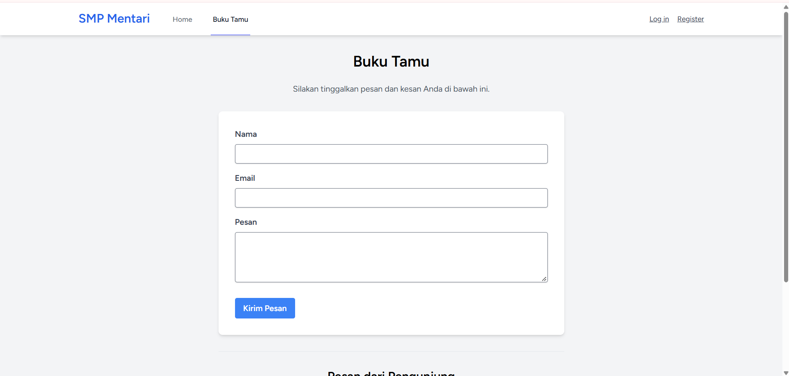
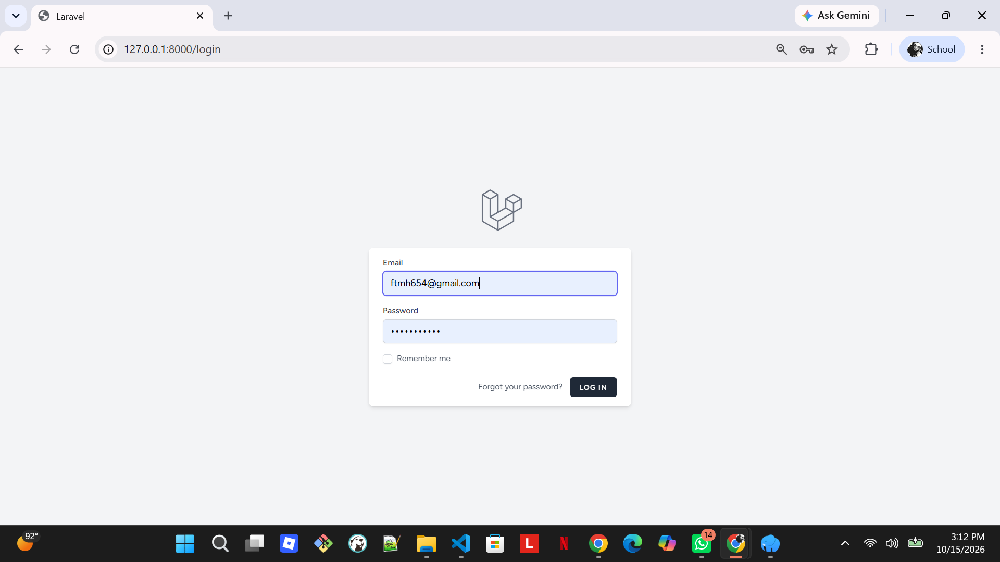
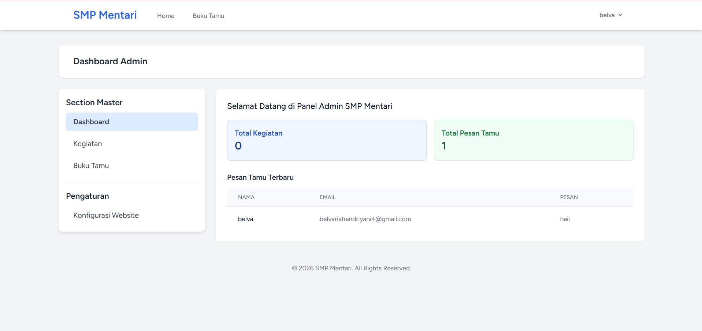

# TUGAS PERTEMUAN 5 - PRAK PEMROGRAMAN BERBASIS WEB

| **Nama** | Fatimah |
|---|---|
| **NPM** | 4524210039 |

---

# Website SMP Mentari Ceria

<p align="center">
  
  
  
</p>

---

   
## Tentang Aplikasi

Website SMP Mentari Ceria adalah aplikasi web sederhana yang dibangun dengan Laravel 12 untuk menampilkan informasi dan kegiatan sekolah. Aplikasi ini dilengkapi dengan fitur buku tamu digital yang memungkinkan pengunjung meninggalkan pesan dan kesan mereka.

### Fitur Halaman:

1. **Halaman Beranda :**  
   - Menampilkan informasi umum sekolah.
   - Menyajikan pengumuman dan kegiatan terbaru
   - Menampilkan dokumentasi kegiatan sekolah.
2. **Buku Tamu :** 
   - Menyediakan formulir untuk mengisi identitas pengunjung.
   - Memungkinkan pengunjung mengirimkan pesan, saran, dan kritik.
   - Menyimpan pesan pengunjung untuk dikelola oleh admin.
3. **Login dan Registrasi :** 
   - Menyediakan fitur autentikasi pengguna.
   - Memungkinkan admin masuk ke halaman pengelolaan.
   - Membatasi akses ke halaman administrasi bagi pengguna yang berwenang.
4. **Panel Administrasi :**
   - Mengelola informasi dan kegiatan sekolah.
   - Menambah, mengedit, dan menghapus data kegiatan.
   - Melihat dan mengelola pesan buku tamu.

## Fitur Utama

- **Jejak Kegiatan Sekolah** - Menampilkan berbagai aktivitas dan acara sekolah dalam bentuk kartu informasi yang menarik.
- **Layanan Buku Tamu Online** - Memfasilitasi pengunjung untuk menyampaikan komentar, saran, maupun pesan melalui website.
- **Validasi Data Pengunjung** - Memastikan nama, alamat email, dan isi pesan diisi sesuai ketentuan sebelum dikirim.
- 2377
- **Notifikasi Pengiriman Pesan** - Memberikan informasi kepada pengguna mengenai keberhasilan atau kegagalan pengiriman pesan.
- **Responsive Design** -  Menyesuaikan tata letak website agar nyaman digunakan melalui komputer, tablet, maupun smartphone.
- **Informasi Waktu Pesan** - Menampilkan perkiraan waktu sejak pesan dikirim, seperti “2 jam yang lalu”.
- **Modern UI/UX** - Menggunakan desain sederhana, rapi, dan konsisten dengan dukungan Tailwind CSS. 

## Tech Stack

### Backend
- **Laravel** 12.x - PHP Framework
- **PHP** ^8.2 - Programming Language
- **SQLite** - Database (Development)
- **Eloquent ORM** - Database Management

### Frontend
- **Blade Templates** - Template Engine
- **Tailwind CSS** 4.0 - CSS Framework
- **Vite** 7.0 - Asset Bundler & HMR
- **Axios** - HTTP Client

### Development Tools
- **Laravel Sail** - Docker Development Environment
- **Pest PHP** - Testing Framework
- **Laravel Pint** - Code Style Fixer
- **Concurrently** - Multi-command Runner

## 🚀 Instalasi

Ikuti langkah-langkah di bawah ini untuk menjalankan proyek secara lokal:

### 1. Clone Repository

```bash
git clone [https://github.com/belvahndryn/Prak_PBW_A_BelvariaHendriyani_24078.git](https://github.com/belvahndryn/Prak_PBW_A_BelvariaHendriyani_24078.git)
cd SMP-Mentari
```

---

### 2. `Install Dependencies`

````markdown

```bash
composer install
npm install
```
````

---

### 3. `Setup Environment`

````markdown
### 3. Setup Environment

```bash
copy .env.example .env
php artisan key:generate
```
````

---

### 4. `Setup Database` (Kredensial .env)

````markdown
### 4. Setup Database

Buka file `.env` dan sesuaikan konfigurasi database Anda di Laragon:

```env
DB_CONNECTION=mysql
DB_HOST=127.0.0.1
DB_PORT=3306
DB_DATABASE=db_smp_mentari
DB_USERNAME=root
DB_PASSWORD=
```
````

```bash
php artisan migrate
```

---

### 5. `Penggunaan` (Menjalankan Server)

````markdown
## 💻 Penggunaan

**Terminal 1 (Backend Server):**

```bash
php artisan serve
```
````

```bash
npm run dev
Aplikasi dapat diakses melalui browser pada alamat: [http://127.0.0.1:8000]
```

📸 Hasil Screenshot Tampilan Website SMP Mentari

### 1. Halaman Home

> 

### 2. Halaman Buku Tamu



### 3. Halaman Register & Login

|     Halaman Register     |     Halaman Login     |
| :----------------------: | :-------------------: |
|  |  |

### 4. Halaman Dashboard Admin


