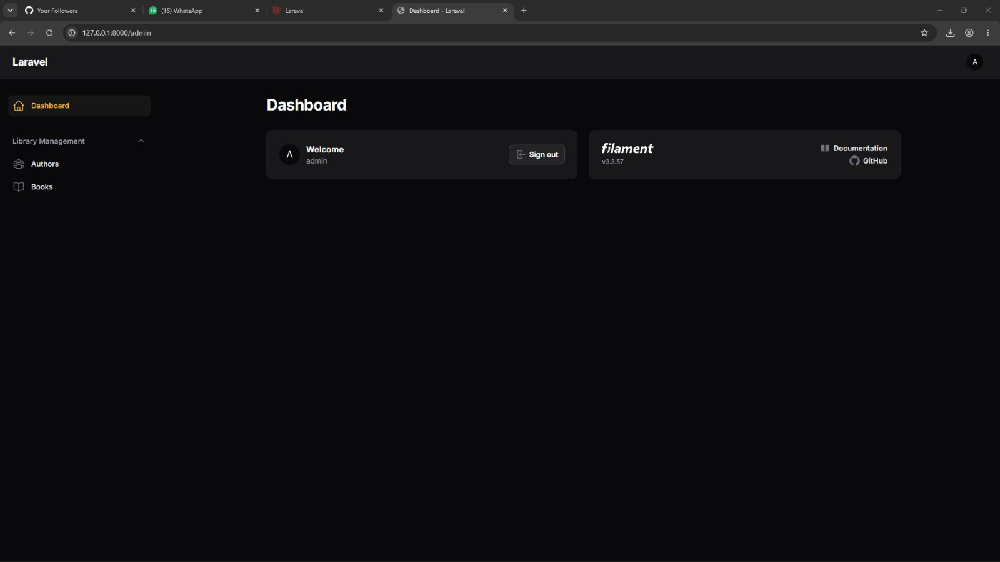
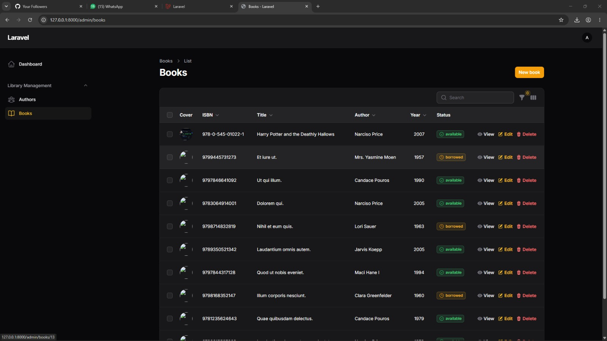
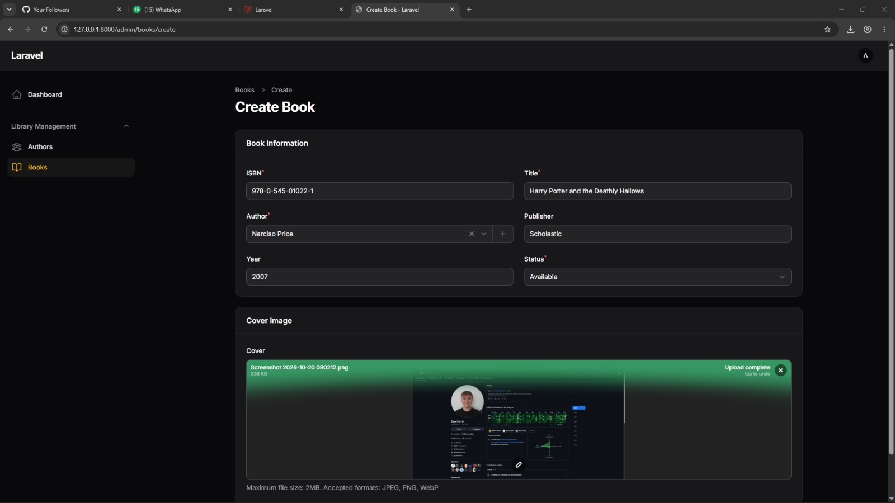
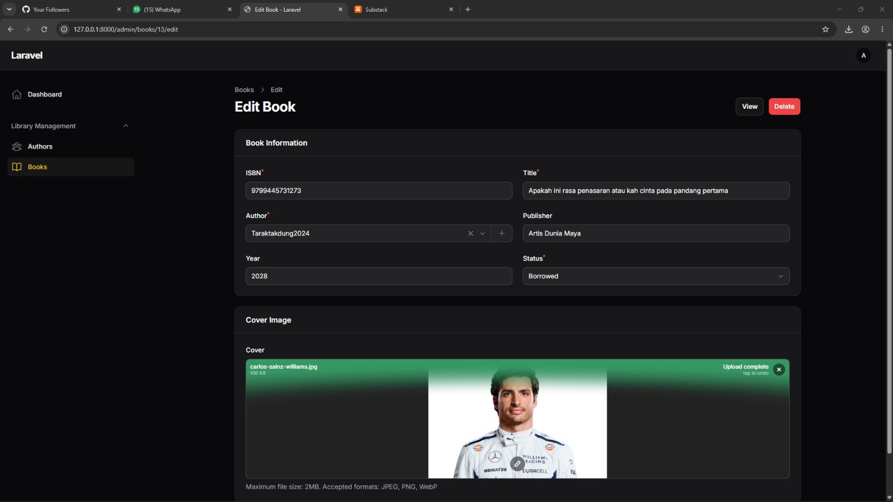
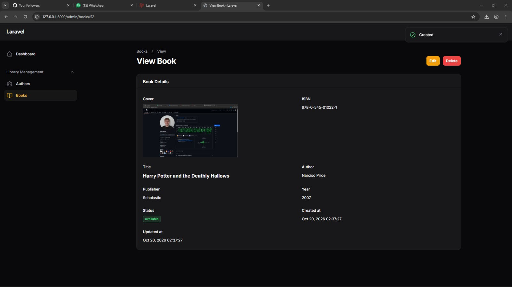
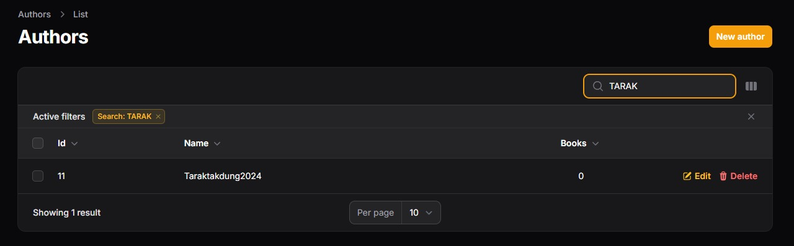
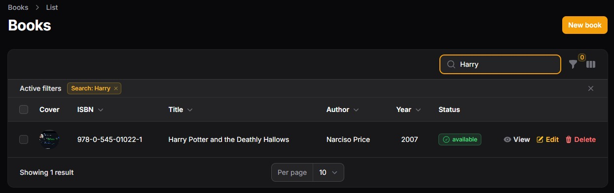
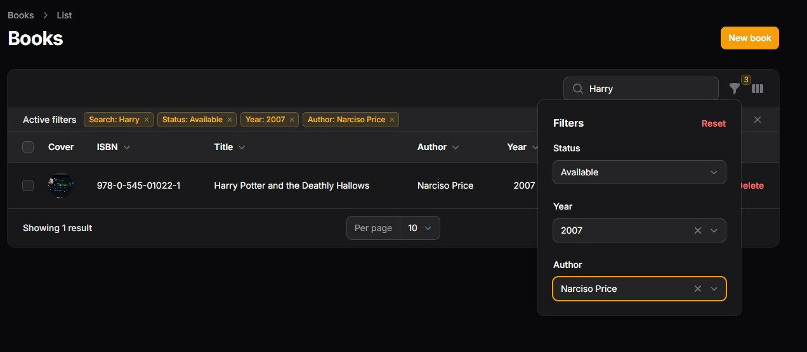

# TUGAS PERTEMUAN 6 - PRAK PEMROGRAMAN BERBASIS WEB

| **Nama** | Fatimah |
|---|---|
| **NPM** | 4524210039 |


# 📚 Authbook — Aplikasi Pengelolaan Buku

**Authbook** merupakan aplikasi berbasis web yang dikembangkan untuk mempermudah proses pengelolaan koleksi buku dan informasi penulis. Proyek ini menggunakan **Laravel 11** sebagai framework utama dan **Filament 3.x** untuk membangun panel administrasi yang praktis dan mudah digunakan.

## ✨ Fitur Aplikasi

1. Login dan Panel Admin
2. Pengelolaan Data Penulis
3. Pengelolaan Koleksi Buku
4. Pencarian dan Penyaringan Data
5. Database Seeder


## 💻 Teknologi yang Digunakan

| Teknologi | Kegunaan |
|---|---|
| PHP 8.2+ | Bahasa pemrograman backend |
| Laravel 11 | Framework pengembangan aplikasi |
| Filament 3.x | Panel administrasi |
| MySQL / MariaDB | Penyimpanan data |
| Composer | Manajemen dependensi PHP |
| Git | Pengelolaan versi kode |
| Laragon / XAMPP | Lingkungan server lokal |

## 🚀 Cara Menjalankan Proyek

### 1. Mengunduh Source Code

Buka terminal, kemudian jalankan perintah berikut:

```bash
git clone https://github.com/username/authbook.git
cd authbook
```

Ganti URL repositori dengan alamat GitHub proyek yang sebenarnya.

### 2. Memasang Dependensi

Instal seluruh library yang dibutuhkan oleh aplikasi menggunakan Composer.

```bash
composer install
```

### 3. Menyiapkan File Environment

Buat file `.env` berdasarkan konfigurasi contoh yang tersedia.

```bash
copy .env.example .env
```

Selanjutnya, buka file `.env` dan atur konfigurasi aplikasi serta database:

```env
APP_NAME=Authbook
APP_URL=http://127.0.0.1:8000

DB_CONNECTION=mysql
DB_HOST=127.0.0.1
DB_PORT=3306
DB_DATABASE=authbook
DB_USERNAME=root
DB_PASSWORD=
```

Pastikan database dengan nama `authbook` sudah dibuat melalui MySQL, phpMyAdmin, atau aplikasi database yang digunakan.

### 4. Membuat Application Key

Jalankan perintah berikut untuk menghasilkan kunci enkripsi aplikasi Laravel.

```bash
php artisan key:generate
```

### 5. Menyiapkan Struktur Database

Jalankan migrasi sekaligus seeder untuk membuat tabel dan memasukkan data awal.

```bash
php artisan migrate:fresh --seed
```

**Perhatian:** Perintah `migrate:fresh` akan menghapus seluruh tabel yang ada pada database yang dikonfigurasi sebelum membuatnya kembali. Gunakan hanya jika data lama memang boleh dihapus.

### 6. Mengaktifkan Penyimpanan Gambar

Agar cover buku yang diunggah dapat ditampilkan melalui browser, jalankan:

```bash
php artisan storage:link
```

Perintah ini membuat tautan dari direktori penyimpanan publik Laravel menuju lokasi file yang diunggah.

### 7. Membuat Pengguna Admin

Jika belum memiliki akun administrator dari proses seeding, buat akun baru menggunakan:

```bash
php artisan make:filament-user
```

Ikuti instruksi pada terminal untuk memasukkan nama, alamat email, dan kata sandi.

### 8. Menjalankan Aplikasi

Pastikan layanan database sudah aktif, kemudian jalankan server Laravel.

```bash
php artisan serve
```

Buka alamat berikut melalui browser:

- **Halaman admin:** http://127.0.0.1:8000/admin
- **Halaman login:** http://127.0.0.1:8000/admin/login

## 🔑 Informasi Login Administrator

Apabila akun berikut memang sudah dibuat oleh seeder proyek, gunakan informasi ini untuk masuk ke panel admin.

| Keterangan | Informasi |
|---|---|
| URL login | `http://127.0.0.1:8000/admin/login` |
| Email | `admin@example.com` |
| Password | `password` |

Kredensial tersebut merupakan contoh akun pengembangan. Pastikan seeder telah membuat akun dengan informasi yang sama. Untuk penggunaan di lingkungan produksi, gunakan kata sandi yang kuat dan jangan menggunakan kredensial bawaan.

## 📸 Hasil Output

Bagian ini berisi dokumentasi hasil implementasi dan pengujian fitur Authbook.

### 1. Halaman Admin Panel Berhasil Login


### 2. Halaman Daftar Buku


### 3. Formulir Penambahan Buku
- Menambahkan Buku : 

- Edit Buku : 

- Liat Buku : 
  

### 4. Pengujian Pencarian
- Pencarian Berdasarkan Penulis : 

- Pencarian Berdasarkan Judul Buku :


### 5. Pengujian Filter Data
