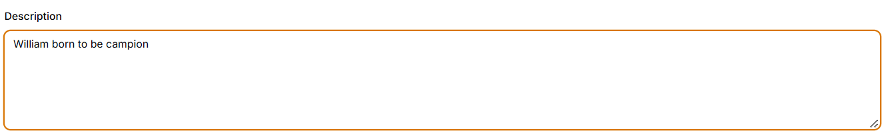
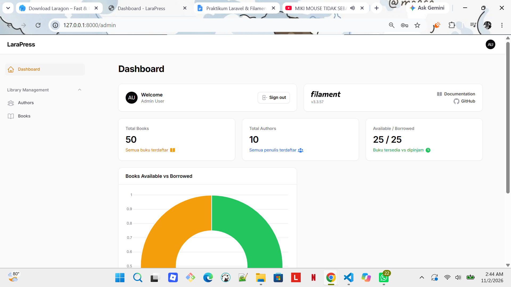
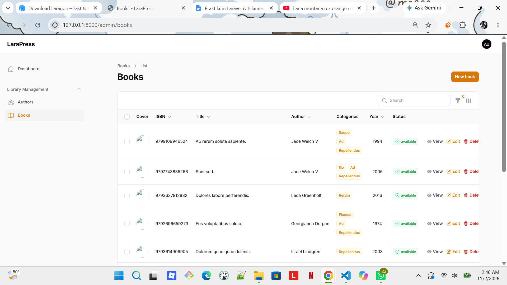
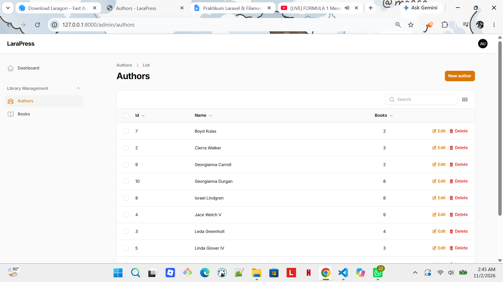
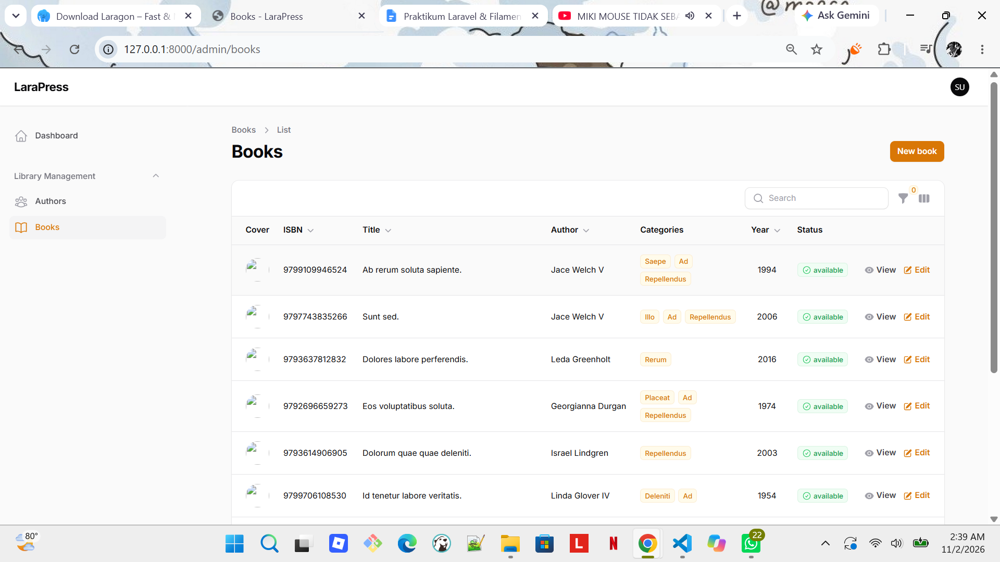
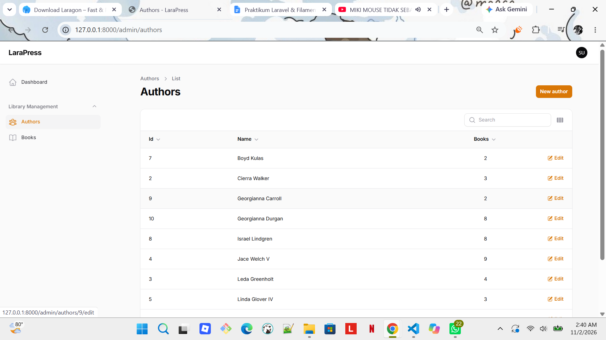
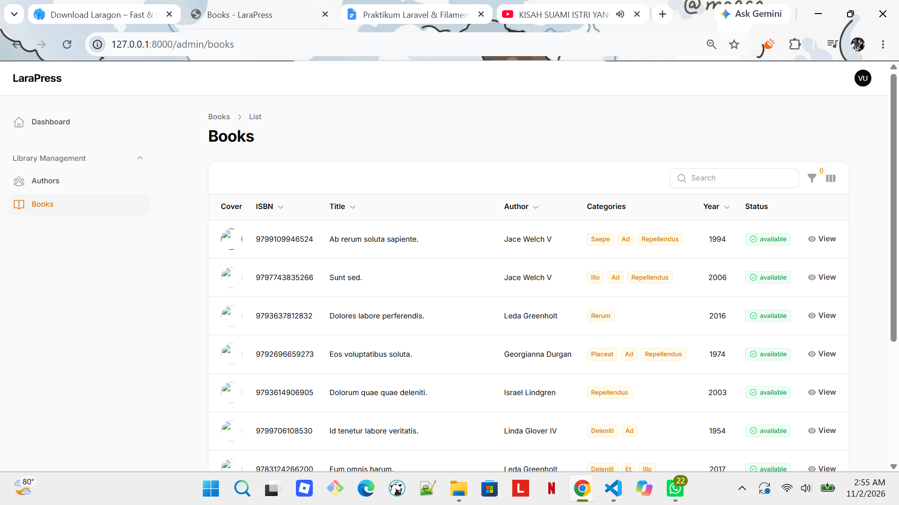
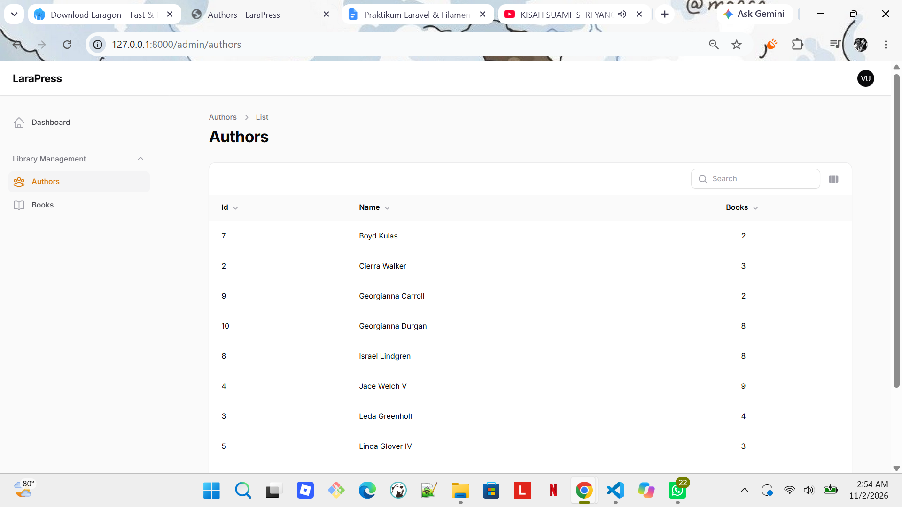
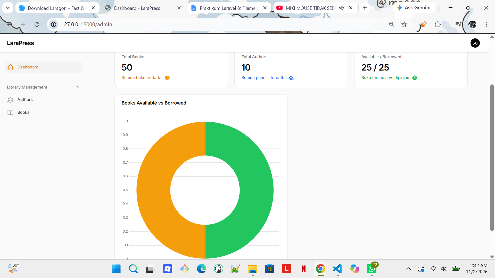
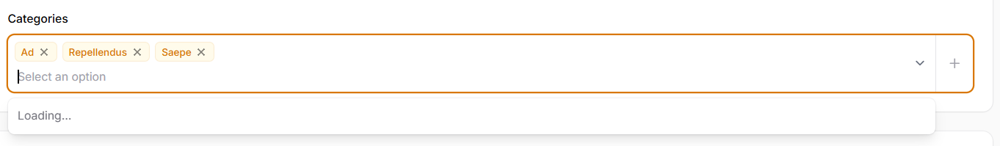

# TUGAS PERTEMUAN 7 - PRAK PEMROGRAMAN BERBASIS WEB

| **Nama** | Fatimah |
|---|---|
| **NPM** | 4524210039 |

# 📚 Authbook — Aplikasi Pengelolaan Buku
**Authbook** merupakan aplikasi berbasis web yang dikembangkan untuk mempermudah proses pengelolaan koleksi buku dan informasi penulis. Proyek ini menggunakan **Laravel 11** sebagai framework utama dan **Filament 3.x** untuk membangun panel administrasi yang praktis dan mudah digunakan.

## 📑 Daftar Isi

1. [Fitur Aplikasi](#fitur-aplikasi)
2. [Teknologi yang Digunakan](#-teknologi-yang-digunakan)
3. [Panduan Instalasi dan Setup Proyek](#-panduan-instalasi-dan-setup-proyek)
4. [Credential Akses](#-credential-akses)
5. [Hak Akses Berdasarkan Role](#hak-akses-berdasarkan-role)
6. [Hasil Output](#hasil-output)
   
## 🛠️ Fitur Aplikasi
1. Login dan Panel Admin
2. Pengelolaan Data Penulis
3. Pengelolaan Koleksi Buku
4. Pencarian dan Penyaringan Data
5. Database Seeder

## 💻 Teknologi yang Digunakan

| Teknologi | Kegunaan |
|---|---|
| PHP 8.2+ | Bahasa pemrograman backend |
| Laravel 11 | Framework pengembangan aplikasi |
| Filament 3.x | Panel administrasi |
| MySQL / MariaDB | Penyimpanan data |
| Composer | Manajemen dependensi PHP |
| Git | Pengelolaan versi kode |
| Laragon / XAMPP | Lingkungan server lokal |


## 🚀 Panduan Instalasi dan Setup Proyek

Ikuti langkah-langkah di bawah ini untuk menjalankan proyek di lingkungan lokal:

### 1. Clone Repositori

```
git clone https://github.com/username/authbook.git
cd authbook

```

### 2. Instal Dependency PHP

Jalankan perintah berikut untuk menginstal seluruh dependensi Laravel dan Filament:

```
composer install

```

### 3. Konfigurasi Environment (`.env`)

Salin file `.env.example` menjadi `.env`:

```
copy .env.example .env

```

Buka file `.env` dan sesuaikan pengaturan database MySQL:

```
APP_NAME=Authbook
APP_URL=http://127.0.0.1:8000

DB_CONNECTION=mysql
DB_HOST=127.0.0.1
DB_PORT=3306
DB_DATABASE=authbook
DB_USERNAME=root
DB_PASSWORD=

```

### 4. Generate Application Key

```
php artisan key:generate

```

### 5. Jalankan Migration dan Seeder

Jalankan migrasi tabel beserta seeder data awal (termasuk akun admin, data _authors_, dan _books_):

```
php artisan migrate:fresh --seed

```

### 6. Buat Symbolic Link Storage

Agar file cover buku yang di-upload dapat diakses secara publik, buat _symlink_ storage:

```
php artisan storage:link

```

### 7. Buat Akun Admin Filament (Opsional)

Jika ingin membuat akun admin baru di luar seeder:

```
php artisan make:filament-user

```

### 8. Jalankan Local Server

```
php artisan serve

```

Akses aplikasi melalui browser di alamat: `http://127.0.0.1:8000/admin`

## 🔐 Credential Akses

Seluruh akun berikut telah disediakan melalui **Database Seeder** dan dapat digunakan untuk masuk ke Admin Panel.

**URL Login:** http://127.0.0.1:8000/admin/login

| Role | Email | Password |
|---|---|---|
| Admin | admin@example.com | password |
| Staff | staff@example.com | password |
| Viewer | viewer@example.com | password |

> **Catatan:** Seluruh akun menggunakan password yang sama, yaitu `password`.

## 🛡️ Hak Akses Berdasarkan Role

Setiap role memiliki hak akses yang berbeda sesuai dengan tanggung jawabnya.

| Hak Akses | Admin | Staff | Viewer |
|---|:---:|:---:|:---:|
| Melihat daftar dan detail buku/penulis | ✅ | ✅ | ✅ |
| Menambah buku/penulis | ✅ | ✅ | ❌ |
| Mengedit buku/penulis | ✅ | ✅ | ❌ |
| Menghapus buku/penulis | ✅ | ❌ | ❌ |
| Bulk Delete (menghapus banyak data sekaligus) | ✅ | ❌ | ❌ |

### Keterangan Role

- **Admin:** Memiliki akses penuh untuk melihat, menambah, mengedit, dan menghapus data buku maupun penulis.
- **Staff:** Dapat melihat, menambah, dan mengedit data buku maupun penulis, tetapi tidak dapat menghapus data.
- **Viewer:** Hanya dapat melihat daftar dan detail buku maupun penulis tanpa melakukan perubahan data.

## 📸 Hasil Output (Tugas 2)

### 1. Description


### 2. Role
1. Role Admin
- Dashboard

- Book 

- Author 


2. Role Staff

- Dashboard

- Book 

- Author 


3. Role Viewer
- Dashboard

- Book 

- Author 


### 3. Widget Dashboard 


### 4. Kategori 

